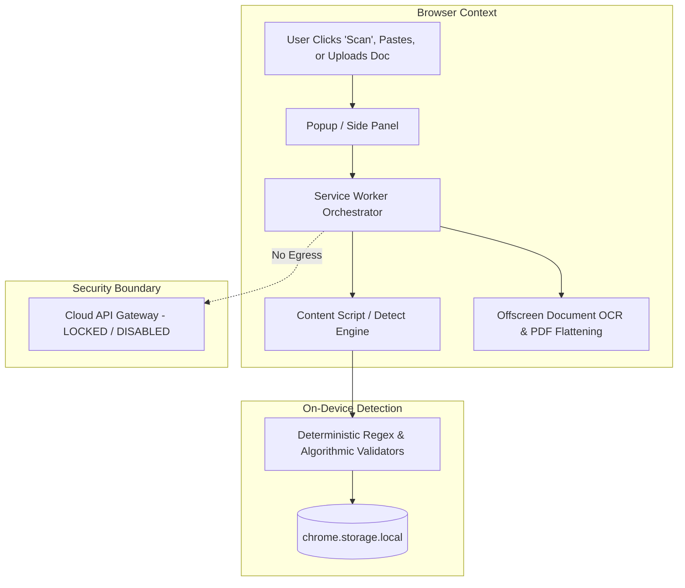
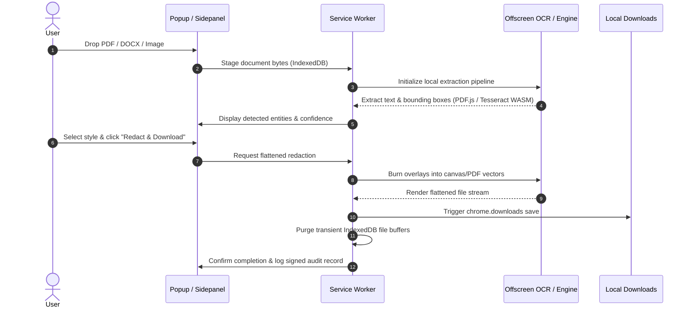

# GovernWorld Extension

[](https://github.com/ACR-LOGIC/governworld-extension/actions/workflows/ci.yml)
[](https://github.com/ACR-LOGIC/governworld-extension/releases/tag/v0.4.0)
[](LICENSE)
[](manifest.json)
[](#local-first-architecture--privacy-guarantees)
[](#browser-compatibility--cross-platform-installation-guide)
[](https://buymeacoffee.com/governworld)
[](https://github.com/sponsors/ACR-LOGIC)

The **GovernWorld Extension** (`v0.4.0`) is a local-first browser protection tool that runs GovernWorld's deterministic detection and redaction engine directly in your web browser. It lets users detect, mask, and redact sensitive Personally Identifiable Information (PII), Protected Health Information (PHI), financial data, credentials, and custom patterns on web pages you choose to scan and in uploaded documents (PDF, DOCX, images). The page text and document content you scan **never leave your device** — the local detection and document pipelines have no network path at all. Optional organizational pairing (`MANAGE` mode) and optional account-linking flows are inactive by default and transmit non-content metadata only when explicitly enabled.

> **Licensing:** GovernWorld Extension is source-available under **Business Source License 1.1 (BSL 1.1)** — free for personal, educational, academic, government, and internal non-commercial use (transitioning to Apache License 2.0 on November 13, 2030). Commercial hosting, resale, or competing products require a separate commercial license from Andres Chavez Ramirez (`andres@acr-logic.com`). This is not an OSI-approved open-source license. See [LICENSE](LICENSE) for details.

---

## Table of Contents
- [Core Capabilities](#core-capabilities)
- [Browser Compatibility & Cross-Platform Installation Guide](#browser-compatibility--cross-platform-installation-guide)
  - [Google Chrome](#1-google-chrome)
  - [Microsoft Edge](#2-microsoft-edge)
  - [Mozilla Firefox](#3-mozilla-firefox)
  - [Brave Browser](#4-brave-browser)
  - [Opera & Opera GX](#5-opera--opera-gx)
  - [Vivaldi](#6-vivaldi)
  - [Arc Browser](#7-arc-browser)
  - [Apple Safari (macOS)](#8-apple-safari-macos--packaging-requires-apple-tooling)
- [Operating Modes: LOCAL vs. MANAGE](#operating-modes-local-vs-manage)
- [Local-First Architecture & Privacy Guarantees](#local-first-architecture--privacy-guarantees)
  - [Provable Local Processing: Wire-Level Network Inspection](#provable-local-processing-wire-level-network-inspection)
- [What Data Remains on Your Device](#what-data-remains-on-your-device)
- [Detection Categories & Global Compliance Presets](#detection-categories--global-compliance-presets)
- [Accessibility & Disability Assistive Features](#accessibility--disability-assistive-features)
- [Multi-Language Internationalization (i18n)](#multi-language-internationalization-i18n)
- [Interactive Redaction Studio & Custom Styles](#interactive-redaction-studio--custom-styles)
- ["Paste, Prompt & Submit" Shield (Chat, prompt & input guard)](#paste-prompt--submit-shield-chat-prompt--input-guard)
- [Right-Click Context Menus](#right-click-context-menus)
- [Interactive Redaction Wizard](#interactive-redaction-wizard)
  - [Rule Persistence & Video Walkthrough](#rule-persistence--video-walkthrough)
- [Document Processing & Redaction Workflow](#document-processing--redaction-workflow)
- [Cloud & API Status (Locked/Gated by Default)](#cloud--api-status-lockedgated-by-default)
- [Browser Permissions & Justifications](#browser-permissions--justifications)
- [Developer Setup & Build Commands](#developer-setup--build-commands)
- [Testing & Quality Verification](#testing--quality-verification)
- [Security & Tamper Resistance](#security--tamper-resistance)
- [💛 Community Support & Sponsorship](#-community-support--sponsorship)
- [License](#license)

---

## Core Capabilities

1. **On-Demand Page Scanning & Visual Masking:**
   - Scans visible page text (and report-only accessibility attributes like `aria-label`, `alt`, `placeholder`, `title`) only after explicit user action.
   - Highlights findings, applies non-destructive visual masks in a shadow-root overlay, and copies securely redacted text (sensitive values replaced with `[REDACTED]`).
   - Structured **possible name** findings are enriched with parsed components (prefix/first/middle/last/suffix/credentials/gender/age/DOB) for review and export; structured names are boosted before thresholding and low-structure names are not auto-selected for masking to reduce false-positive redaction.
   - Coverage is reported honestly (including truncated/partial/no-readable-text cases). A page with no readable text is not reported as a clean scan; image-only pages can be routed into the Document Studio via detected image candidates.
   - Keyboard shortcuts (rebindable at `chrome://extensions/shortcuts`): `Alt+Shift+E` opens popup, `Alt+Shift+S` scans page, `Alt+Shift+M` applies/removes masks, `Alt+Shift+P` opens side panel.

2. **"Paste, Prompt & Submit" Shield (on-demand, policy-aware):**
   - Intercepts `paste`, `beforeinput`, drag-and-drop text, prompt `Enter` submissions, and `<form>` submits on editable surfaces (including rich editors, open shadow roots, and same-origin iframes) in activated contexts.
   - Shows a Shadow DOM review dialog with masked previews and actions to sanitize, send/paste unchanged, or cancel; interception is synchronous so blocked/sanitized data is not inserted/submitted.
   - Protection modes: **Off**, **This tab** (default, no site access required), **Always on** (requires runtime-granted optional `http://*/*` + `https://*/*` access; revoking stops coverage). Status is reported only with proof (never claims active without grant/registration).
   - Integrates with site policies, destination/compliance evaluation, and local audit recording.

3. **Interactive Document Redaction Studio (PDF / DOCX / images):**
   - Drag-and-drop/select PDF, DOCX, and image files. Long documents are disclosed before scanning and processed by user-chosen page windows (partial passes are clearly labeled and named, e.g. `*-redacted-p21-40.pdf`).
   - Uses native text layers where available (digitally-born PDFs/DOCX layout text) and bundled offline OCR only for pages with no text of their own (this build bundles English; unbundled OCR languages fail closed).
   - Interactive review: toggle detected boxes, draw custom boxes, choose **Blackout / Whiteout / Text Stamp**, full-screen review with zoom, then produce flattened, verified redacted output and print/PDF view. Staged document bytes stay local and are cleaned up by lifecycle/clear flows.

4. **Detection, Presets & Structured Intelligence:**
   - Deterministic local detectors/validators across 24 categories: `email`, `phone`, `ssn`, `dob`, `medical_record_number`, `member_id`, `npi`, `dea`, `mbi`, `address`, `payment_card`, `secrets`, `possible_name`, `custom`, `canadian_sin`, `uk_nhs`, `aadhaar`, `pan_india`, `australian_tfn`, `cpf`, `ip_address`, `username`, `bank_account`, `financial`.
   - Built-in compliance presets: **Custom, HIPAA, PCI DSS, GDPR, Developer, PIPEDA, UK GDPR/NHS, India DPDP, Australia Privacy, Brazil LGPD**. Confidence thresholds, category toggles, and custom patterns are locally configurable.
   - Name intelligence uses `detectNames` as the sole `possible_name` span detector plus census-backed structured parsing/enrichment (`nameParser`/`nameDictionaries`) attached as `Finding.parsedName`.

5. **Custom Logic, Policy Studio & Governance:**
   - Redaction/Logic Wizard for creating/testing custom detection rules locally; offline custom-rules JSON export/import with schema validation, ReDoS-safe checks, and duplicate-safe merge.
   - Policy Studio for site-specific DLP rules (URL scopes, templates, category scopes, block/auto-redact/warn, full-site access blocking barrier) with audited enforcement.
   - Enterprise MANAGE mode supports one-time pairing via organization pairing codes, dynamic signed policy distribution, administrative policy lockdown (locking required categories and modes while keeping accessibility tools unlocked), and periodic lightweight health checks (see `docs/ENTERPRISE_DEPLOYMENT.md`).

6. **Auditability, Exports & Reports:**
   - ECDSA P-256 signed, metadata-only local audit trail for scans, masking, document operations, policy/preset changes, and audited actions.
   - Exports: signed audit log, printable compliance certificate (`governworld-compliance-certificate-*.html`), and findings export as **CSV** (including structured name columns) and **JSON** (including `parsedName`).
   - Explainable compliance/risk scoring and scorecards in page scan, Document Studio, and review surfaces (with PHI/AI-leakage evaluation logic).

7. **UI, Accessibility & Localization:**
   - Popup/side panel surfaces (Protection, Logic, Review, Settings) with full-screen document review.
   - UI languages: **English, Spanish, French, German, Japanese, Portuguese, Simplified Chinese**.
   - Accessibility: font scaling, high contrast, dyslexia-friendly spacing, reduced motion, verbose ARIA, and screen-reader announcements (Web Speech API/ARIA live regions).

8. **Right-Click Context Menus (on-demand):**
   - **Scan page for sensitive data**; and when text is selected, **Redact selection to clipboard** and **Mask selected text**.
   - Selection actions appear only with a selection. Actions report success/failure (badge/feedback) and relevant actions are audited. Entries can be disabled in settings.

9. **Clinical/PHI Evidence & Compliance Intelligence (local):**
   - Layered clinical/PHI evidence and compliance evaluation (structured identifiers, clinical vocabulary/signatures, diagnoses/meds/procedures, domain context, and evidence aggregation) feeding explainable risk decisions and scorecards. Detection is heuristic/pattern-based and not exhaustive.

10. **Optional Integrations (explicit, non-default):**
   - Optional runtime notification permission for scan/findings notices.
   - Optional account linking / extension-license flows (user-provided gateway origin + session credential) and community/account/policy-sync surfaces are present in UI/architecture but network/community submission/retrieval paths are disabled or gated by default in this build; core detection/redaction remains fully local and offline-capable. No scan content or raw sensitive values are transmitted by local protection flows.

---

## Browser Compatibility & Cross-Platform Installation Guide

GovernWorld is engineered to conform to the **W3C WebExtensions Manifest V3 specification** and runs seamlessly across all modern desktop web browsers.

```
| Browser | Status | Notes |
|---|---|---|
| Chrome 116+ | **Shipped and verified** | Manifest V3. The build target; every automated gate runs against it. |
| Edge 116+ | **Shipped and verified** | Chromium-based; same MV3 build as Chrome. |
| Brave, Opera, Vivaldi, Arc | Supported, unverified | Chromium-based and load the same unpacked build. Not covered by the automated gates, so treat as untested rather than confirmed. |
| Firefox 109+ | **Packaged (`npm run build:firefox`)** | Own MV3 manifest (`manifest.firefox.json`), locked add-on id, sidebar panel. Page protection, paste guard, and scanning ship; Document Studio needs an offscreen-capable runtime, so document jobs report an explicit error where it is absent. Browser-run QA pending — see `BROWSER_SUPPORT.md`. |
| Safari | **Payload only, not distributable from here** | `npm run build:safari` produces the web-extension file set; packaging it into a signed app requires a Mac with Xcode (`xcrun safari-web-extension-packager`) or App Store Connect (Apple Developer Program). No distributable Safari artifact is claimed. |
```

### Build the Package First
Before loading into any browser, build the production bundle:
```bash
git clone https://github.com/ACR-LOGIC/governworld-extension.git
cd governworld-extension
npm install
npm run build
```
This outputs the packaged extension into the `dist/` directory.

---

### 1. Google Chrome
1. Open Google Chrome and navigate to `chrome://extensions/`.
2. Turn ON the **Developer mode** toggle in the top-right corner.
3. Click the **Load unpacked** button in the top-left corner.
4. Select the `dist/` folder inside the cloned repository.
5. Click the puzzle icon in the Chrome toolbar and pin **GovernWorld** for quick access.

---

### 2. Microsoft Edge
1. Open Microsoft Edge and navigate to `edge://extensions/`.
2. In the left-hand sidebar, enable the **Developer mode** toggle.
3. Click **Load unpacked** at the top of the page.
4. Select the `dist/` folder from this repository.
5. Click the extension icon in the Edge toolbar to start protecting pages!

---

### 3. Mozilla Firefox
`manifest.firefox.json` is the Firefox MV3 manifest (own locked add-on id,
event-page background, `sidebar_action` panel) packaged by
`npm run build:firefox` into `dist-firefox/`. Page scanning, paste protection,
and masks ship; the Document Studio reports an explicit error on runtimes
without the offscreen API instead of failing silently.

#### Temporary / Developer Installation:
1. Open Firefox and navigate to `about:debugging#/runtime/this-firefox`.
2. Click the **Load Temporary Add-on...** button.
3. Navigate to the `dist-firefox/` directory and select `manifest.json`.
4. The GovernWorld shield icon will appear in your Firefox toolbar.

#### Persistent Unbranded / Developer Edition Installation:
- Pack `dist-firefox/` into a `.zip` file, rename to `.xpi`, and install via `about:addons` > **Install Add-on From File...**.

---

### 4. Brave Browser
1. Open Brave and navigate to `brave://extensions/`.
2. Toggle ON **Developer mode** in the top-right corner.
3. Click **Load unpacked** in the top-left corner.
4. Select the `dist/` directory.
5. Pin the GovernWorld extension in the Brave toolbar.

---

### 5. Opera & Opera GX
1. Open Opera and navigate to `opera://extensions/`.
2. Toggle ON **Developer mode** in the top-right corner.
3. Click **Load unpacked extension**.
4. Select the `dist/` folder.
5. Pin the extension in your Opera toolbar.

---

### 6. Vivaldi
1. Open Vivaldi and navigate to `vivaldi://extensions/`.
2. Enable **Developer mode** (top-right toggle).
3. Click **Load unpacked** and choose the `dist/` directory.

---

### 7. Arc Browser
1. Open Arc and press <kbd>Cmd</kbd>+<kbd>,</kbd> (or <kbd>Ctrl</kbd>+<kbd>,</kbd> on Windows) to open **Settings**.
2. Go to **Extensions** > click **Open Extensions Page** (or navigate to `arc://extensions/`).
3. Turn ON **Developer mode**.
4. Click **Load unpacked** and select the `dist/` folder.

---

### 8. Apple Safari (macOS) — packaging requires Apple tooling
Safari cannot load a Chrome extension directly. `npm run build:safari`
produces the web-extension file set in `dist-safari/`; turning it into an
installable Safari extension requires packaging it as an app — either with
Xcode on a Mac or through App Store Connect (Apple Developer Program) — which
is unavailable on this build machine. No distributable Safari artifact is
claimed; see `BROWSER_SUPPORT.md` for the exact blocker and commands.

With Xcode installed, the packaging step is:

1. Ensure Xcode is installed with Command Line Tools:
   ```bash
   xcode-select --install
   ```
2. Package the built payload (note: the current tool is
   `safari-web-extension-packager`, the renamed `safari-web-extension-converter`):
   ```bash
   xcrun safari-web-extension-packager /path/to/governworld-extension/dist-safari --project-location /path/to/output --app-name "GovernWorld"
   ```
3. Open the generated Xcode project and click **Run** to build the macOS container app.
4. In Safari, go to **Settings** > **Advanced** > check **"Show features for web developers"**.
5. Go to **Develop** menu > check **"Allow Unsigned Extensions"**.
6. In **Safari Settings** > **Extensions**, enable **GovernWorld**.

A Safari web extension governs supported activity inside Safari only — not
iMessage, native apps, or the OS.

---

## Operating Modes: LOCAL vs. MANAGE

GovernWorld Extension v0.4.0 supports two user-facing operating modes:

```text
+-----------------------------------------------------------------------------------+
|                                  OPERATING MODES                                  |
+-----------------------------------------------------------------------------------+
|  1. LOCAL (Default on Install)                    2. MANAGE (Enterprise Paired)   |
|  - Standalone, on-device processing                 - Paired via 6-digit code/GPO |
|  - Zero network calls, zero heartbeats              - Signed policy pull & lock   |
|  - Zero background alarms or coordination           - Accessibility stays unlocked|
|  - User controls rules, presets, and thresholds     - 15-min lightweight heartbeat|
|  - Local ECDSA P-256 signed audit trails            - Offline continuity enforced |
|  - Offline OCR & local document flattening          - Zero browsing surveillance  |
+-----------------------------------------------------------------------------------+
```

### 1. LOCAL Mode (Standalone Operation — Default on Install)

In **LOCAL mode**, the extension starts and runs as an autonomous, self-contained on-device privacy tool:
- **Zero Connections on Install:** Makes zero network attempts, runs zero background alarms, and emits zero heartbeats.
- **No Mandatory Account or Subscription:** Core PII/PHI detection, page masking, and document redaction work immediately without registration or sign-in.
- **User Autonomy:** You control detection categories, presets, confidence thresholds, custom regex rules, and visual/accessibility preferences.
- **Local Cryptographic Audit:** Security events are stored locally in `chrome.storage.local` with detached ECDSA P-256 signatures and SHA-256 hash chaining.

### 2. MANAGE Mode (Administrator-Managed Operation — Opt-In / Paired)

**MANAGE mode** activates only when an organization deploys OS-level managed policy (`chrome.storage.managed`) or an employee explicitly pairs the browser using a 6-digit pairing code or Enterprise Device Enrollment under **Settings → Profile & Account**:
- **Pairing & Policy Synchronization:** Validates the pairing code with the organization's Office Coordinator (`http://127.0.0.1:4820` or HTTPS coordinator URL), records `ManagementEnrollment` with the device's public installation UUID, and downloads signed administrator rules (`Ed25519` signature + anti-rollback version check + anti-replay nonce/timestamp window).
- **Administrative Feature Lockdown vs. Employee Accommodations:**
  - **Locked by Administrator:** Protection modes (`always-on` / `this-tab`), mandated detection categories, preset selection, category filter buttons, confidence threshold overrides, network destination rules, and the custom pattern wizard button are locked so compliance baselines cannot be switched off.
  - **Unlocked for Employees:** Accessibility and personal usability settings (font scaling, high contrast, dyslexia mode, reduced motion, speech announcements, verbose ARIA, mask highlight colors, UI language, and local notification preferences) remain fully adjustable.
- **Periodic Lightweight Heartbeat Status Checks:** Strictly post-pairing (never in standalone `LOCAL` mode), `chrome.alarms` schedules a 15-minute check transmitting only non-sensitive health metadata (`device_id`, `organization_id`, `employee_id`, `browser_info`, `extension_version`, `policy_version`, `policy_status`, `timestamp`, `status`).
- **Zero Surveillance Boundary:** Browsing history, visited URLs, search queries, page text, form inputs, keystrokes, credentials, emails, chats, uploaded documents, OCR text, and detected findings **never leave the device**.
- **Offline Continuity:** If the coordinator is unreachable, the extension continues enforcing the last valid policy locally and never fails open.

---

## Extension Policy Updates vs. Extension Software Updates

It is critical to distinguish between dynamic policy synchronization and browser extension software updates:

| Attribute | Extension Policy Updates | Extension Software Updates |
| :--- | :--- | :--- |
| **Source** | GovernWorld Office Manager / policy coordinator via signed envelopes | Browser Web Stores (Chrome Web Store, Firefox AMO, Edge Add-ons) |
| **Delivery Mechanism** | Extension-initiated retrieval (HTTPS / localhost coordinator; MANAGE mode only) | Browser native auto-update mechanism (`update_url`) |
| **Payload** | JSON policy payload with Ed25519 signature & targeting | Bundled extension ZIP/CRX/XPI binary (JS, HTML, CSS, WASM) |
| **Frequency** | Dynamic, post-pairing (startup, enrollment, 15-min alarm intervals) | Version releases (e.g. v0.3.0 -> v0.4.0) |
| **User Disruption** | Zero: hot-applied in memory and session state | Extension restarts / reload upon browser update |
| **Integrity Check** | Ed25519 signature verified against pinned public key | Cryptographic store signing and browser manifest verification |
| **Rollback Defense** | Monotonic `policy_version` check (rejects older versions) | Browser store rollback policies |

---

## Detection & Redaction Limitations Disclosure

GovernWorld Extension is engineered for high-assurance data privacy, but users must understand its explicit boundaries:

1. **Pattern-Based Heuristic Limitations:**
   - Pattern-based detection (regular expressions, dictionary lookups, and algorithmic checksums) is not guaranteed to detect 100% of sensitive entities in unstructured human text.
   - Ambiguous names, atypical handwriting, non-standard address formats, or novel credential patterns may not be flagged automatically.
   - **User Verification Required:** Users must review highlighted entities and masked previews before disseminating redacted documents or submitting data to external destinations.

2. **Visual Masking vs. Flattened Content Redaction:**
   - **Web Page Masking:** Overlays temporary visual privacy masks in an isolated Shadow DOM. The underlying web page DOM text is not modified unless the user uses the *Sanitize & Paste* or *Redact Selection to Clipboard* actions.
   - **Document Studio Redaction:** Flattens redactions directly into the vector stream and raster canvas of PDF, DOCX, and image files. Bounding box regions are completely overwritten with solid pixels or blackout vectors. Supposedly removed text is stripped from the document's internal text layer and metadata.

3. **Unsupported Content & Surfaces:**
   - **Canvas/WebGL Elements:** If a web application renders text purely onto an HTML5 `<canvas>` or WebGL surface without an underlying DOM text layer or accessibility tree, on-demand DOM scanning cannot read that text. Users should capture an image and process it via the Document Redaction Studio.
   - **Protected / Encrypted Media:** DRM-protected media, encrypted streaming video, and native browser UI (address bar, browser settings) cannot be inspected.
   - **Native Applications:** The extension operates solely inside the web browser environment and does not inspect external desktop applications, terminal windows, or native OS clipboards outside browser boundaries.

---

## Troubleshooting & Diagnostics

- **Operating Mode Badge Displays "LOCAL":** The extension is in standalone mode with zero coordinator connections. To enroll in enterprise management, enter your organization's 6-digit pairing code or enrollment credentials in **Settings → Profile & Account**.
- **Operating Mode Badge Displays "MANAGE":** The extension is actively paired or OS-managed. Administrator-mandated modes, categories, thresholds, and rule wizards are locked while accessibility settings stay editable.
- **Document Studio Reports "No Text Layer Found":** Scanned PDFs or photos without embedded text automatically invoke the bundled offline Tesseract OCR engine. Ensure the document is right-side up and legible.
- **Diagnostic Export:** Download the signed audit ledger via the **Review** tab (**Export signed audit log**) or **Settings → Privacy → Export signed audit log**.

---

## Local-First Architecture & Privacy Guarantees

GovernWorld Redaction is built from the ground up on a **local-processing-by-default** security model:



- **Zero Cloud Transmission:** No document contents, raw page text, or extracted sensitive values are ever sent over the network.
- **Zero Remote Code Execution:** Strict Manifest V3 Content Security Policy (`script-src 'self' 'wasm-unsafe-eval'`). All scripts, WebAssembly binaries, and OCR models are bundled locally.
- **Zero Automatic Host Access:** Declares **zero `host_permissions`**. The extension cannot automatically observe or access network traffic or website origins.

### Provable Local Processing: Wire-Level Network Inspection

Local processing in GovernWorld is **provable at the network wire layer**, not merely an unverified marketing claim. To facilitate rigorous security review and provide transparent privacy assurances, the codebase includes an automated wire-level network inspection test:

```bash
npm run test:network-inspection
```

#### What This Test Verifies:
1. **Zero External Egress:** Spawns an isolated local test harness and executes full page DOM scanning, custom logic wizard generation, interactive regex testing, and selection redactions against high-sensitivity synthetic canaries (never-issued SSN, test payment cards, confidential emails, medical PHI diagnoses, system passwords, and API keys).
2. **Wire-Level Traffic Auditing:** Intercepts every HTTP/HTTPS request, WebSocket connection, `fetch()`, `XMLHttpRequest`, and beacon emitted across the renderer, background service worker, and extension pages.
3. **Leak-Free Assertions:** Asserts that **0 requests** are made to external hosts or cloud endpoints, **0 analytics or telemetry calls** are dispatched, and **0 sensitive canaries** appear in any URL query string, request header, or payload body.
4. **Offline Asset Integrity:** Proves that local WebAssembly runtimes (`tesseract-core.wasm`), language models (`eng.traineddata.gz`), and PDF worker scripts are resolved exclusively from local extension storage via `chrome.runtime.getURL`.

---

## What Data Remains on Your Device

| Data Type | Storage Location | Persistence / Lifecycle |
| :--- | :--- | :--- |
| **User Settings & Active Preset** | `chrome.storage.local` | Retained locally until cleared by user. |
| **Custom Redaction Rules** | `chrome.storage.local` | Retained locally; managed via Redaction Wizard. |
| **Transient Scan Findings** | `chrome.storage.session` | Ephemeral; purged when browser closes. |
| **Document File Buffers** | Extension IndexedDB (`governworld-redaction`) | Transient; automatically deleted after redaction download or session reset. |
| **Audit Log Entries** | `chrome.storage.local` | Metadata-only (timestamps, category counts, ECDSA signatures); zero raw values stored. |

---

## Detection Categories & Global Compliance Presets

Deterministic, local detectors/validators cover 24 categories (configurable with per-category confidence thresholds):

| Group | Categories |
|---|---|
| PII / contact | `email`, `phone`, `address`, `dob`, `possible_name` (structured parsing/enrichment), `ip_address`, `username` |
| Government / health IDs | `ssn`, `medical_record_number`, `member_id`, `npi`, `dea`, `mbi`, `canadian_sin`, `uk_nhs`, `aadhaar`, `pan_india`, `australian_tfn`, `cpf` |
| Financial | `payment_card`, `bank_account`, `financial` |
| Secrets / custom | `secrets`, `custom` |

Notes: validators/checksum logic includes SSN/ITIN, Luhn payment cards, NPI/DEA/MBI, Canadian SIN, UK NHS, Aadhaar, PAN, Australian TFN, Brazilian CPF, and related international/credential patterns as implemented in `src/validators` and `src/content/detect.ts`. `possible_name` uses `detectNames` for spans plus census-backed structured parsing (`nameParser`/`nameDictionaries`) attached as `Finding.parsedName`.

### Built-in Compliance Presets
**Custom, HIPAA, PCI DSS, GDPR, Developer, PIPEDA, UK GDPR/NHS, India DPDP, Australia Privacy, Brazil LGPD.** Presets auto-select relevant categories; edits revert to Custom as applicable. Category selection and thresholds are enforced locally (and can be constrained in MANAGE mode).

---

## Accessibility & Disability Assistive Features

GovernWorld is designed to be accessible to all users, including those who are blind, low-vision, or have dyslexia:

- **Font Size & Visual Scaler:** Choose from `Default (100%)`, `Medium (115%)`, `Large (130%)`, or `Extra Large (150%)`.
- **High Contrast Mode:** Pure black backgrounds, cyan accents, and bold borders.
- **Dyslexia-Friendly Mode:** Expanded letter spacing, line height, and high-readability text formatting.
- **Reduced Motion:** Disables animations and sliding transitions for users sensitive to motion.
- **Screen Reader Voice Announcements:** Uses the standard Web Speech API (`speechSynthesis`) and ARIA live regions (`role="status"`, `aria-live="polite"`) to announce scan findings, counts, and download actions.
- **Verbose ARIA Mode:** Extends accessible descriptions for full keyboard navigation and NVDA/JAWS/VoiceOver compatibility.

---

## Multi-Language Internationalization (i18n)

The extension provides interface translation across 7 languages with instant switching and local persistence:
- 🇺🇸 **English** (`en`)
- 🇪🇸 **Español** (`es` - Spanish)
- 🇫🇷 **Français** (`fr` - French)
- 🇩🇪 **Deutsch** (`de` - German)
- 🇯🇵 **日本語** (`ja` - Japanese)
- 🇵🇹 **Português** (`pt` - Portuguese)
- 🇨🇳 **简体中文** (`zh` - Simplified Chinese)

---

## Interactive Redaction Studio & Custom Styles

- **Supported inputs:** PDF, DOCX, and images (`.png`, `.jpg`, `.webp`). Digitally-born PDFs/DOCX use native text where available; OCR is used only for pages with no text of their own (English bundled; unbundled languages fail closed).
- **Page windows:** documents longer than one pass are disclosed and scanned by user-chosen windows (e.g. pages 21–40 of 45), with persistent partial-scan warnings and windowed artifact naming.
- **Interactive review:** toggle detected boxes, draw custom redaction boxes, choose **Blackout / Whiteout / Text Stamp**, and use full-screen review/zoom before producing output.
- **Flattening & verification:** redactions are applied to output artifacts (not at print time), with verified/confirmed coverage stages surfaced in the workflow; print/PDF view renders the verified redacted pages.
- **Local staging:** document bytes/previews are staged in extension-private storage and cleaned up by clear/completion/lifecycle flows (see storage section).

---

## "Paste, Prompt & Submit" Shield (Chat, prompt & input guard)

Guards against pasting credentials, PHI, or PII into any browser input —
AI chats, web forms, SaaS apps, rich-text editors — not a list of AI
companies. Provider names may appear in the UI to orient you, but enforcement
keys off editable surfaces, so an unknown AI clone on an unlisted hostname is
covered exactly like a known one:
- Intercepts `paste`, `beforeinput`, and drag-and-drop text on `input`,
  `textarea`, and `[contenteditable]` elements, including editors inside open
  shadow roots and same-origin iframes.
- Intercepts direct `Enter` keystrokes on AI chat inputs, message composers,
  and query bars, as well as `<form>` submit events, preventing accidental
  transmission of sensitive data that was typed or auto-filled.
- Displays a floating Shadow DOM review modal near the input.
- Actions: **Sanitize & Send / Sanitize & Paste** (replaces secrets with `[REDACTED]`), **Send Unchanged / Paste Unchanged**, or **Cancel** (<kbd>Esc</kbd>).
- Interception happens synchronously before insertion or submission: a blocked or sanitized
  submission never reaches the destination. A dialog fault transmits nothing.

### Protection modes — what is active, and when

| Mode | Meaning |
|---|---|
| Off | No paste interception. Explicit scans and redaction still work. |
| This tab (default) | Pastes are guarded in tabs you explicitly authorize by opening GovernWorld there. Needs no site access. |
| Always on | Guarded on every site you visit — only after you grant site access in the browser prompt. Revoking the grant stops coverage. |

The practical consequence, stated plainly:

| Situation | Guard active? |
|---|---|
| This-tab mode, you opened GovernWorld on the chat site, then paste | Yes |
| This-tab mode, you invoked a GovernWorld shortcut or context-menu action on the tab, then paste | Yes |
| This-tab mode, you open a chat site in a new tab and paste without touching GovernWorld first | **No** |
| Always-on mode with site access granted, any site, new tabs and restarts included | Yes |
| Always-on selected but site access denied or revoked | **No** — the UI says it is waiting for access, never that it is active |
| You close or reload a tab (this-tab mode) and paste again | **No**, until you activate GovernWorld on that tab again |

This-tab is the default because the extension installs with no install-time
host permissions: it has no presence in a tab until the user acts on it. The
content script is injected on demand (via an `activeTab` grant from the
toolbar action, the context menu, or the keyboard shortcut). Always-on is the
explicit opt-in for standing access — requested at runtime as optional
`http://*/*` + `https://*/*` origins (never the `<all_urls>` blanket), and
revocable at any time. See [PERMISSIONS.md](docs/security/PERMISSIONS.md) for what is
requested and why, and `BROWSER_SUPPORT.md` for per-browser coverage.

---

## Right-Click Context Menus

GovernWorld integrates directly into the browser right-click context menu:
- **Scan page for sensitive data:** Triggers an on-demand page scan.
- **Redact selection to clipboard:** Copies highlighted text with sensitive data masked (available when text is selected).
- **Mask selected text:** Immediately overlays visual privacy masks on the selected text (available when text is selected).

Selection actions appear only when there is a selection to act on. The tab icon
shows a tick when an action completed and `!` when it did not, so a right-click
is never indistinguishable from a no-op. Actions that transform/release page
content are recorded in the local audit trail.

---

## Interactive Redaction Wizard

The **Redaction Wizard** enables users to construct custom detection logic locally:
1. **Examples:** Provide positive match examples and negative exclusion examples.
2. **Analysis:** Generates candidate regex patterns locally using sample text.
3. **Sandbox Test:** Test candidate patterns against interactive sample text in real time.
4. **Save Locally:** Save rules directly into `chrome.storage.local` for immediate use in scans and document redactions.

### Offline Custom Rules Backup & Migration (Export & Import)

To migrate custom detection logic between browsers or maintain local backups:
- **Export Rules:** Generates an offline, formatted JSON file (`governworld-custom-rules-YYYY-MM-DD.json`) containing your defined regex patterns, flags, categories, and confidence ratings.
- **Import Rules:** Ingests a JSON rules export locally. All imported patterns undergo strict schema validation (`parseCustomPattern`), ReDoS denial-of-service protection checks (`isSafeRegex`), and duplicate-safe merging by rule UUID. Any categories associated with imported rules are automatically activated in active settings.
- **Zero Remote Egress:** The export and import mechanisms operate exclusively client-side via standard HTML5 File and Blob APIs with zero network egress.

### Rule Persistence & Video Walkthrough

Rules created via the Logic Wizard are saved directly into `chrome.storage.local` under the `customPatterns` key and are instantly activated for subsequent page scans, document redactions, and selection masks whenever the user wants them:
- **Automatic Category Activation:** Saving a custom rule automatically ensures its category is enabled in active settings.
- **Immediate Detection:** Subsequent scans and mutation-observer delta passes immediately load the saved custom rules to highlight and mask target entities.
- **Automated Verification & Video Recording:** Run `npm run test:wizard-flow` to execute the full automated browser journey (example input -> regex analysis -> sandbox test -> rule persistence -> live webpage scan) and record a clean demonstration video saved to `recordings/logic-wizard-demo.webm`.

---

## Document Processing & Redaction Workflow



---

## Cloud & API Status (Locked/Gated by Default)

The extension is **fully functional in standalone local mode**.
- **Local-first by default:** detection, OCR, and redaction run on-device. Default install declares **no install-time host permissions** (optional `http://*/*` + `https://*/*` exists only for user-approved Always-on paste protection).
- **Gated/disabled integrations:** cloud/community submission and retrieval paths are stubbed or unavailable by default in this build; optional account/license flows are explicit and separate from scan/redaction content. Local protection flows do not transmit page/document/scan content.
- **API-ready architecture:** interfaces/hooks exist for future optional integrations, but core functionality does not depend on them.

---

## Browser Permissions & Justifications

| Permission | Purpose & Justification |
| :--- | :--- |
| `activeTab` | Grants temporary, user-gesture access to the active tab when you scan, use shortcuts, or invoke context-menu actions. Never runs automatically. |
| `scripting` | Injects the local scanning/content script and renders visual overlay masks in the active tab after explicit user action. |
| `storage` | Stores settings, custom rules, local audit records, and transient session/document state metadata in extension storage. |
| `downloads` | Saves flattened, redacted output files and user-requested exports (audit/certificate/findings) to the user's computer. |
| `offscreen` | Hosts PDF rendering and WebAssembly OCR execution without stalling the browser UI. |
| `sidePanel` | Provides a persistent side panel (`Alt+Shift+P`) for protection, document review, logic, and settings. |
| `contextMenus` | Adds right-click actions: **Scan page for sensitive data** and, when text is selected, **Redact selection to clipboard** and **Mask selected text**. |
| `alarms` | Schedules periodic lightweight status checks and policy synchronization strictly when paired in MANAGE mode. Completely inactive with zero network calls in standalone LOCAL mode. |
| `notifications` *(optional, runtime)* | Requested only if you enable scan/findings notifications. |
| `http://*/*`, `https://*/*` *(optional host access, runtime)* | Requested only for **Always on** paste protection so pages can be guarded on visited sites. Default install declares no host permissions; revoking the grant stops always-on coverage. |

---

## Developer Setup & Build Commands

### Prerequisites
- Node.js 22.13+ (per `package.json` engines)
- npm 10+

### Build Commands
```bash
# Clone repository
git clone https://github.com/ACR-LOGIC/governworld-extension.git
cd governworld-extension

# Install dependencies
npm install

# Typecheck TypeScript sources
npm run typecheck

# Run the full Vitest suite (count and current result: see the CI badge above)
npm test

# Run browser verification & Chromium E2E tests
npm run verify:browser

# Build production bundle to dist/
npm run build
```

---

## Testing & Quality Verification

The codebase includes an extensive automated test suite covering all detection algorithms, redaction output integrity, wizard behavior, manifest compliance, and audit trails:

- **Unit & Integration Tests:** the full Vitest suite via `npm test`, with the current pass count reported by the CI badge above. Counts are not hard-coded here on purpose - a stale number in a README is worse than no number.
- **Wire-Level Network Inspection:** Automated protocol-level audit asserting zero sensitive data egress, zero external requests, and zero telemetry during scans and wizard operations (`npm run test:network-inspection`).
- **Logic Wizard E2E & Video Walkthrough:** End-to-end browser test verifying rule creation, local persistence, and live webpage redaction with automated video capture (`npm run test:wizard-flow`).
- **Browser Automation Verification:** Real Chromium browser validation (`npm run verify:browser`).
- **Photo OCR & Coordinate Mapping E2E:** End-to-end verification of document OCR, coordinate mapping, and pixel flattening (`npm run test:photo-e2e`).
- **Cross-Browser Verification:** Tests verifying compatibility across Chrome, Edge, Firefox, Safari, and Brave (`tests/cross-browser-compatibility.test.ts`).

---

## Security & Tamper Resistance

- **Signed Audit Trail:** Every scan, mask application, document export, and policy change generates an ECDSA P-256 signed audit record stored locally.
- **Verifiable Compliance Certificate:** Alongside cryptographic JSONL audit logs, GovernWorld exports self-contained, printable HTML Compliance Certificates (`governworld-compliance-certificate-*.html`) attesting to verified local execution, action counts, and cryptographic public key fingerprints.
- **Integrity Invariants:** Unit tests verify that audit logs fail closed if file downloads or delivery pipelines are intercepted.
- For vulnerability reports or security inquiries, please see [SECURITY.md](SECURITY.md).

---

## 💛 Community Support & Sponsorship

GovernWorld is **free for non-commercial use and source-available** with local-first processing by default:
- **On-Device Content Protection:** Page scanning, OCR text extraction, and document flattening run on your local device; scanned page text and uploaded documents stay on your machine.
- **Zero Data Monetization:** We never sell, log, monetize, or transmit your sensitive documents, scanned values, or browsing activity.
- **Free for Community Use:** Every core protection capability is freely accessible for personal, educational, academic, government, and internal non-commercial use.

If GovernWorld saves you time or protects your sensitive workflows, you can support ongoing development, maintenance of offline models, and validator improvements:

<p align="center">
  <a href="https://github.com/sponsors/ACR-LOGIC" target="_blank" rel="noopener noreferrer">
    
  </a>
  &nbsp;
  <a href="https://buymeacoffee.com/governworld" target="_blank" rel="noopener noreferrer">
    
  </a>
</p>

You can also contribute by submitting new regex/checksum patterns, opening issues, or contributing code as outlined in [CONTRIBUTING.md](CONTRIBUTING.md).

---

## License

Copyright (c) 2026 Andres Chavez Ramirez. All rights reserved.

GovernWorld Extension is **source-available** under **Business Source License 1.1 (BSL 1.1)** ([LICENSE](LICENSE)): free for personal, educational, academic, government, and internal non-commercial company use, transitioning to Apache License 2.0 after November 13, 2030. Commercial use, redistribution, resale, hosting, SaaS offerings, or competing products require a separate commercial license from Andres Chavez Ramirez (`andres@acr-logic.com`). This is not an open-source (OSI-approved) license.
