# GovernWorld Chrome Extension — UI/UX Redesign Review Package

**Branch:** `feat/ux-redesign-user-flows` (branched cleanly from `main` at `eaa16b3`)  
**Design Plan:** [`docs/design/UI_UX_REDESIGN_PLAN.md`](./UI_UX_REDESIGN_PLAN.md)  
**Target Emphasis:** Individual-First with Unified Progressive Disclosure

---

## 1. Visual Comparison (Before vs. After)

All screenshots below were captured in **headed Chromium (`dist/`)** with zero console or page errors.

### A. Popup Home & Header (`380x600` Before -> `390x600` After)

| Before (`main@eaa16b3`) | After (`feat/ux-redesign-user-flows`) |
|---|---|
| 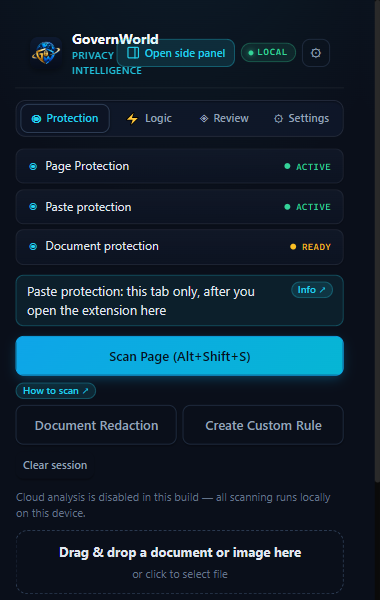 | 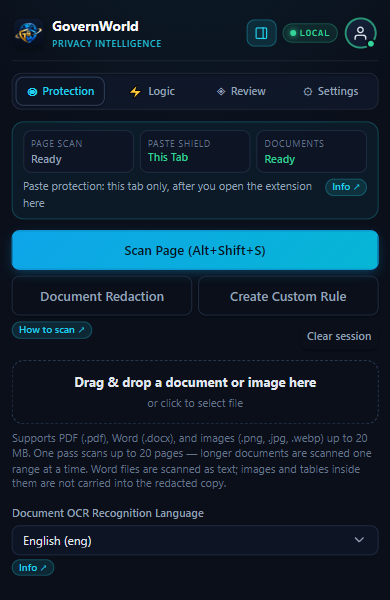 |

**What Changed:**
- **Eliminated Header Collision:** Replaced the colliding `[Open side panel] [LOCAL] [⚙]` group with a crisp non-overlapping layout (`GovernWorld / PRIVACY INTELLIGENCE` on the left; compact Side Panel button, `LOCAL`/`MANAGE` pill, and **circular Profile Avatar button** on the top-right).
- **Eliminated Static Fake-Green Rows & Bloat:** Replaced the 3 hardcoded `.service-row` cards and duplicate Paste banner with a compact **Live Protection Status Strip** (`Page Scan`, `Paste Shield`, `Documents`) wired to live runtime state.
- **First-Run Onboarding:** Added a dismissible First-Run Welcome card wired to `settings.disclosureAcknowledged` (`Got it` + optional 1-click `Enable Always-On Shield`):  
  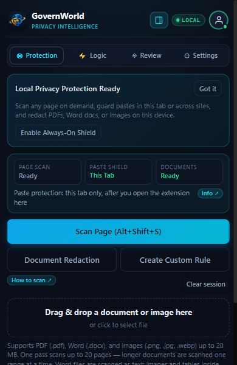

---

### B. Circular Profile Avatar & Popover (New)

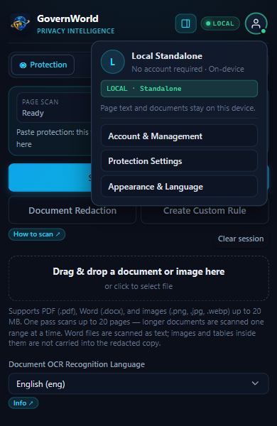

- Clicking the circular top-right avatar button (`#profile-avatar-btn`) opens an accessible, keyboard-dismissible (`Esc` & outside-click) **Profile & Mode Popover** showing:
  - Identity (`Local Standalone · No account required · On-device`, or linked workspace email/org)
  - Operating Mode & status ring (`LOCAL` emerald, `Linked` cyan, `MANAGE` cobalt)
  - On-device guarantee (`Page text and documents stay on this device.`)
  - Direct quick-jumps to **Account & Management**, **Protection Settings**, and **Appearance & Language**
  - Preserves `#org-settings` vs `#org-settings-wall` privilege separation and session-only `accountApiKey` storage.

---

### C. Side Panel Space Utilization (`600x800`)

| Before (`main@eaa16b3`) | After (`feat/ux-redesign-user-flows`) |
|---|---|
| 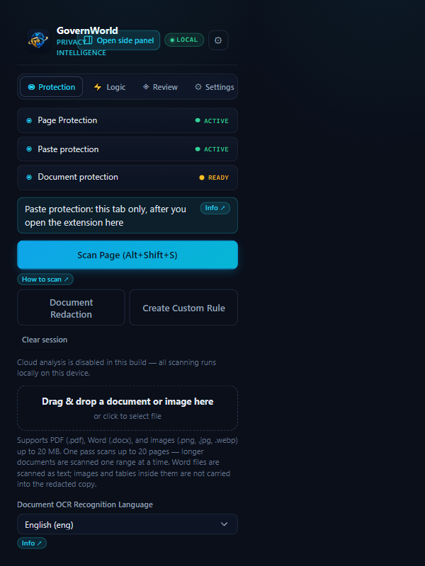 | 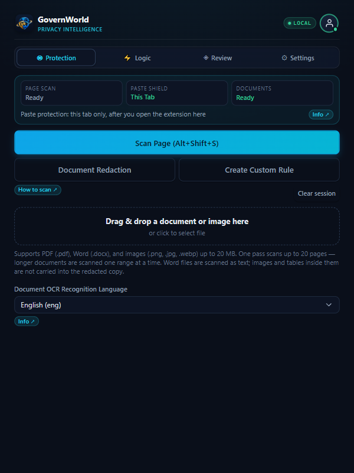 |

**What Changed:**
- Removed the `html, body { width: 360px }` lock so the Side Panel expands fluidly across narrow (`420x800`) and wide (`600x800+`) panels, and `redact.html` inherits full tab width.
- Automatically hides `#open-side-panel-btn` when running inside the Side Panel (`data-surface="sidepanel"`).
- **Narrow Side Panel (`420x800`):** 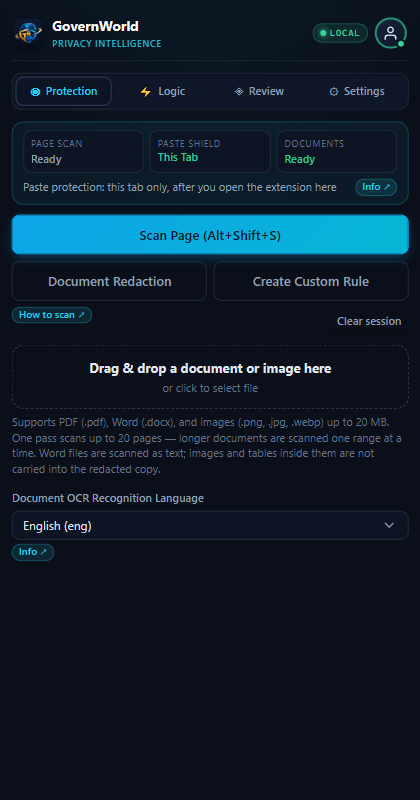

---

### D. Active Page Scan Findings (`390x600`)

| Before (`main@eaa16b3`) | After (`feat/ux-redesign-user-flows`) |
|---|---|
| 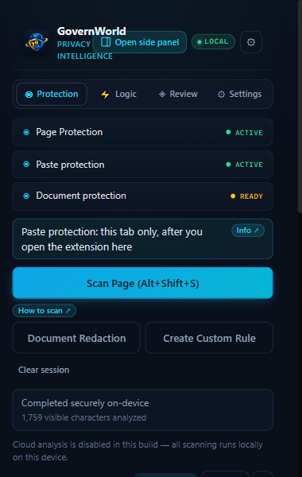 | 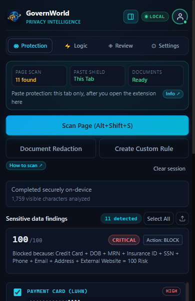 |

**What Changed:**
- Compact live status strip updates `PAGE SCAN` to `11 found` while keeping the **Compliance Risk Scorecard (`100/100 CRITICAL`)** and findings list immediately visible above the fold.
- Replaced `window.confirm()` on Findings Export with an inline `CSV` / `JSON` export bar.

---

### E. Settings Navigation & Sub-Pages

| Before Popup (`main@eaa16b3`) | After Popup (`390x600`) | After Wide Side Panel (`600x800`) |
|---|---|---|
| 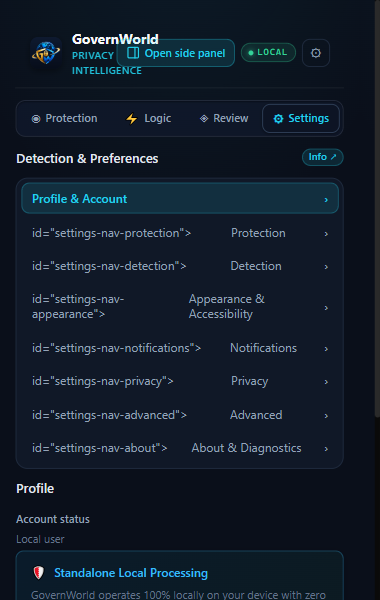 | 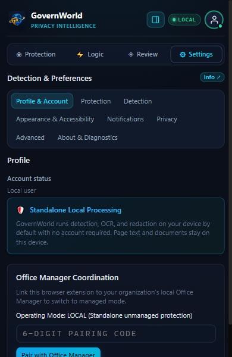 | 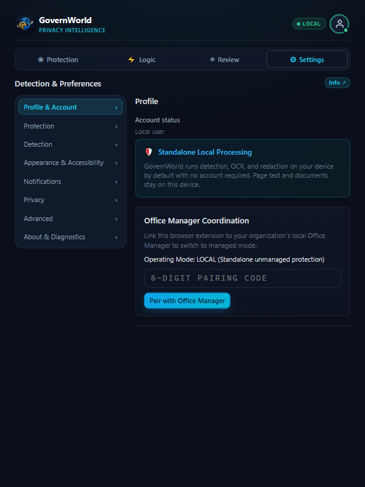 |

**What Changed:**
- Fixed the 7 malformed `> id="settings-nav-..."` HTML tags that rendered raw `id="settings-nav-..."` text in the Popup.
- Popup renders a wrapped 2-row pill bar so all 8 sections fit with zero clipping; Wide Side Panel (`>= 520px`) renders a sticky `184px` left navigation rail beside the active Settings panel.
- Organized `About & Diagnostics` with diagnostics & audit controls at top and collapsible `
` sections for Explainers, Open-Source Credits, Support, and the 21 Feature Guides (auto-expanding when a `[data-guide]` help link is clicked).
- Removed the simulated `"GovernWorld Medical Practice"` lock fallback on Office Manager pairing failure (`127.0.0.1:4820`), reporting an honest connection error instead.

---

### F. Review & Activity Tab (Wired to Real Telemetry)

| Before (`main@eaa16b3`) | After Popup (`390x600`) | After Side Panel (`600x800`) |
|---|---|---|
| 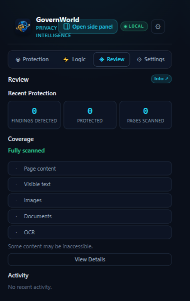 | 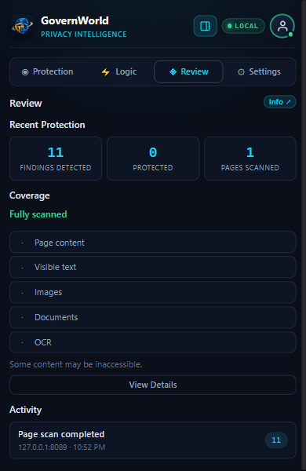 | 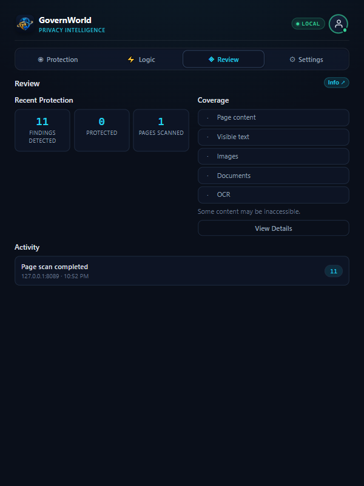 |

**What Changed:**
- Wired `#review-findings-count`, `#review-protected-count`, `#review-pages-count`, `#activity-list`, and `#activity-empty` to real `auditLog` events and active session state.
- Fixed `#coverage-details-btn` to switch to `Settings -> Privacy`.
- Fixed `#clear-audit-btn` to remove `"auditLog"` and `"auditCheckpointState"` and refresh Review counts immediately.
- Added a 2-column `.review-overview-grid` in wide Side Panel view.

---

### G. Logic Tab, Document Studio & Full-Screen Review

| Logic (`390x600`) | Side Panel Document Studio | Full-Screen Review (`review.html`) |
|---|---|---|
| 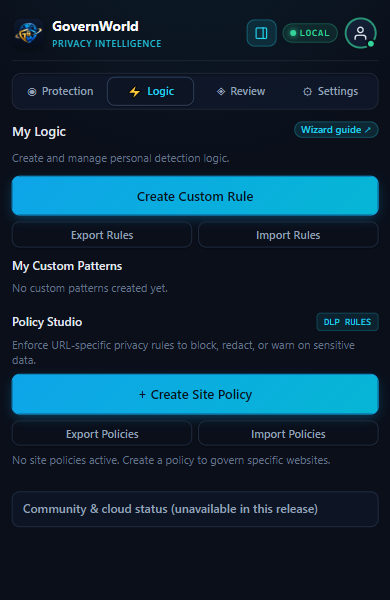 | 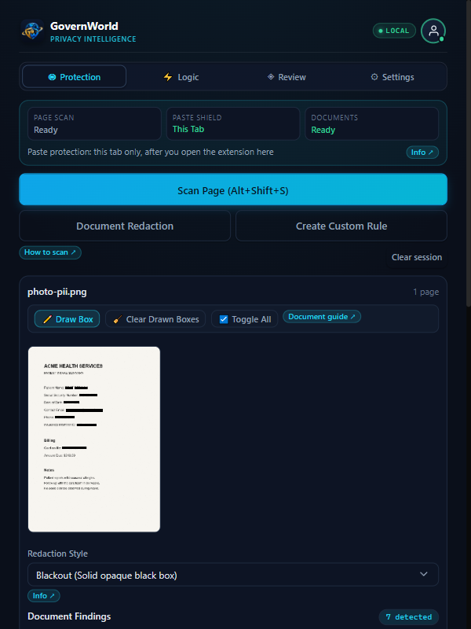 | 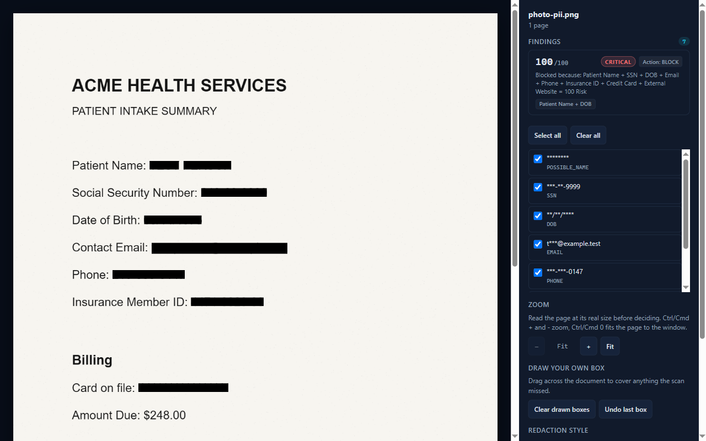 |

**What Changed:**
- **Logic:** Tucked unavailable Community/Cloud controls cleanly into a collapsed disclosure (`Community & cloud status (unavailable in this release)`) and replaced `alert()` calls in the Wizard with inline validation errors.
- **Document Studio:** Fixed `.doc-thumb-canvas` positioning (`position: absolute; inset: 0`) so redaction preview boxes align directly over the document thumbnail, and added Popup -> Side Panel handoff on `#open-doc-btn` / `#doc-dropzone` so clicking upload in an ephemeral popup opens the persistent Side Panel instead of letting the OS file picker dismiss the popup.

---

## 2. Files Modified / Added

- `src/popup/index.html` — Header + circular `#profile-avatar-btn` & `#profile-popover`, `#first-run-welcome`, compact Live Protection Status Strip, `#export-format-menu`, fixed 7 `settings-nav-*` tags, collapsible About & Community disclosures, inline Wizard error elements, reconciled `24` categories & `claims-accuracy` wording.
- `src/popup/popup.css` — Responsive fluid `html, body` & `.app` layout, Side Panel `>= 520px` multi-column Review & Settings rail, circular avatar & popover styling, `.doc-thumb-canvas` overlay fix, high-contrast trailing comma fix, zero dead CSS classes.
- `src/popup/popup.ts` — Context-aware header & Side Panel auto-hide, avatar/popover state & keyboard handling, live protection strip & Firefox `isDocumentPipelineSupported()` honesty, `disclosureAcknowledged` welcome card, Popup -> Side Panel doc handoff, wired Review telemetry & `#coverage-details-btn`, fixed `#clear-audit-btn` storage keys, removed fake Office Manager lock fallback, replaced `confirm()`/`alert()`.
- `src/sidepanel/sidepanel.html` & `src/sidepanel/sidepanel.css` — Synced via `npm run sync:sidepanel`.
- `src/popup/review.css`, `src/popup/redact.html`, `src/content/toast.ts`, `src/content/pasteGuard.ts` — Harmonized Obsidian-Slate + Cyan Shield tokens and full-width `redact.html` fix.
- `src/shared/i18n.ts` — Added all new UI keys across all 7 languages (`en, es, fr, de, ja, pt, zh`) and removed `"Proactive"` wording.
- `tests/ux-redesign-flows.test.ts` — Automated contract tests for the redesigned flows and bug fixes.
- `docs/design/UI_UX_REDESIGN_PLAN.md`, `docs/design/REDESIGN_REVIEW.md`, `docs/design/screenshots/{before,after}/*.png`.
